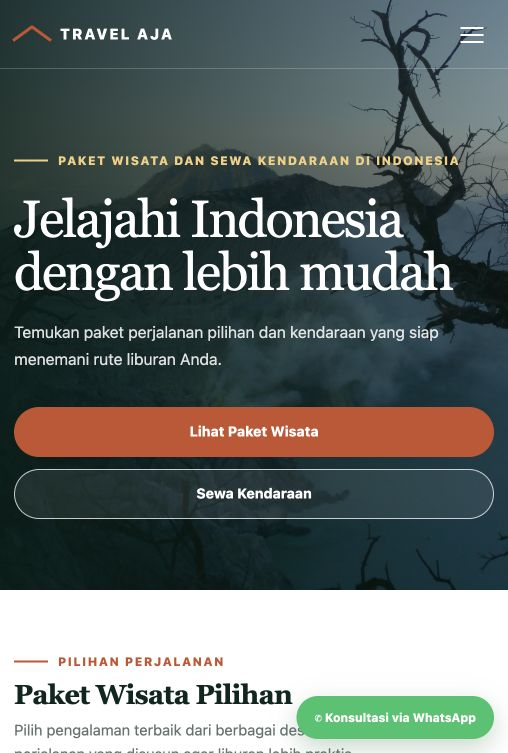
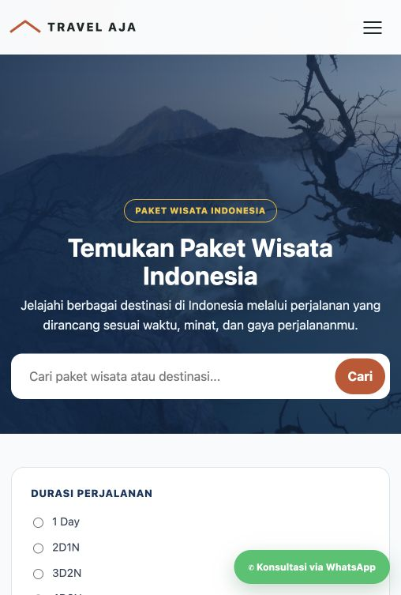
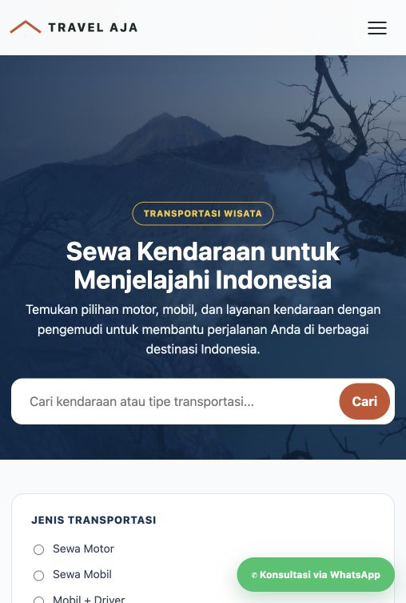

# Travel Aja

**Travel Aja** is a bilingual (Indonesian/English) WordPress travel catalog for Indonesian destinations, tour packages, and vehicle rentals. Visitors can browse, filter, and sort listings, then start a consultation through WhatsApp. It is built as a classic parent and child theme, with custom post types registered by a companion plugin and Polylang for translations. The travel guide archive also includes an accessible image gallery dialog.

Katalog perjalanan dwibahasa untuk destinasi, paket wisata, dan sewa kendaraan di Indonesia. Pengunjung dapat mencari, memfilter, dan mengurutkan katalog, lalu menghubungi tim melalui WhatsApp.

  
  
  

**Status:** Dalam pengembangan; disiapkan sebagai demo portofolio.

**Lisensi:** Belum ditetapkan. Sampai file `LICENSE` ditambahkan, repo ini belum memberi izin penggunaan ulang.

## Fitur

- Katalog destinasi, paket wisata, dan transportasi dengan pencarian, filter, pengurutan, dan pagination.
- Navigasi dan halaman Indonesia/Inggris melalui Polylang.
- WhatsApp untuk memulai konsultasi dengan pesan yang sudah disusun dari detail perjalanan.
- Galeri artikel dengan dialog gambar yang mendukung tombol Escape dan navigasi keyboard.
- Ilustrasi placeholder lokal untuk item demo yang belum memiliki Featured Image.

## Teknologi

WordPress 6.8.2 · PHP 8.5.10 (versi lokal saat screenshot dibuat) · JavaScript · CSS · Polylang · WordPress Playground.

## Coba demo

Setelah repo ini publik di GitHub, gunakan [Launch Travel Aja in WordPress Playground](https://playground.wordpress.net/?blueprint-url=https%3A%2F%2Fraw.githubusercontent.com%2Fvidakomaria%2Ftravel_aja%2Fmain%2Fblueprints%2Fplayground.json). Blueprint memasang plugin konten dan kedua tema, mengimpor data WXR, lalu membuka beranda. Pratinjau Playground menggunakan konten Indonesia; Polylang dan pasangan terjemahan diatur lewat setup lokal di bawah. Playground menggunakan WordPress 6.8.2 dan PHP 8.3; koneksi internet diperlukan.

Blueprint mengikuti format resmi WordPress Playground: [Blueprints](https://developer.wordpress.org/playground/blueprints/) dan [Steps](https://developer.wordpress.org/playground/blueprints/steps/).

Screenshot di atas diambil dari instalasi lokal yang sudah ada, bukan dari data WXR sintetis. Tidak terlihat nomor WhatsApp atau nama pribadi. Pada hasil impor, plugin menyediakan ilustrasi lokal sebagai gambar cadangan; teks dan itemnya mengikuti XML demo.

## Kebutuhan

- WordPress **6.8.2** dan PHP **8.5.10** adalah versi instalasi lokal yang digunakan saat menangkap screenshot.
- `Custom Theme` dan `Custom Theme 2` dari repo ini; aktifkan child theme `Custom Theme 2`.
- Plugin **Travel Aja Content Types** dari `wp-content/plugins/travel-aja-content/`. Plugin ini mendaftarkan CPT yang dipakai tema, terpisah dari tema agar item konten tetap tersedia saat tema diganti.
- **Polylang** untuk fitur dwibahasa. Situs satu bahasa dapat berjalan tanpa plugin ini.
- **WordPress Importer** bila mengimpor WXR manual lewat wp-admin; Blueprint Playground mengimpor konten lewat langkah `importWxr`.

WP Travel Engine tidak diperlukan oleh tema atau plugin konten di repo ini. Pasang hanya jika membutuhkan fiturnya secara terpisah.

## Setup lokal

1. Siapkan WordPress lokal. Versi yang dipakai untuk demo repo ini adalah WordPress 6.8.2 dengan PHP 8.5.10.
2. Salin `custom-theme`, `custom-theme-v2`, dan `travel-aja-content` ke folder tema/plugin instalasi WordPress. Aktifkan plugin **Travel Aja Content Types**, lalu aktifkan **Custom Theme 2**. Jika instalasi lama memakai CPT UI untuk mendaftarkan slug yang sama, nonaktifkan definisi ketiga post type di CPT UI agar tidak didaftarkan dua kali; data konten dengan slug yang sama tetap dipakai.
3. Untuk situs bilingual, pasang Polylang, tambahkan bahasa Indonesia dan English, lalu hubungkan pasangan terjemahan halaman dan konten.
4. Impor [`demo-content/travel-aja-demo.xml`](demo-content/travel-aja-demo.xml) melalui **Tools → Import → WordPress**. Pilih pengguna lokal untuk konten dengan penulis `demo`.
5. Pastikan halaman berikut tersedia; buat manual jika belum ada setelah impor. Slug mengarahkan ke template tema yang sesuai:

   | Bahasa Indonesia | Slug | Bahasa Inggris | Slug |
   | --- | --- | --- | --- |
   | Beranda | `beranda` | Home | `home` |
   | Destinasi | `destinasi` | Destinations | `destinations` |
   | Paket Wisata | `paket-wisata` | Tour Packages | `tour-packages` |
   | Transportasi | `transportasi` | Vehicle Rental | `vehicle-rental` |
   | Panduan Wisata | `panduan-wisata` | Travel Guides | `travel-guides` |
   | Tentang Kami | `tentang-kami` | About Us | `about-us` |

6. Di **Settings → Reading**, pilih **Beranda** sebagai homepage statis dan **Panduan Wisata** sebagai halaman tulisan bila menggunakan arsip panduan. Hubungkan halaman terjemahan di Polylang, lalu susun menu di **Appearance → Menus**.
7. Isi WhatsApp dan informasi footer lewat **Appearance → Customize**. Gambar demo otomatis dipakai sebagai placeholder sampai Featured Image diganti.

### Tipe konten dan field

Plugin mendaftarkan post type `destinasi`, `paket_wisata`, dan `transportasi`. Tema menyediakan field kartu:

- **Destinasi:** Lokasi, Rating, Kategori, Aktivitas Unggulan, Lencana.
- **Paket Wisata:** Durasi, Lokasi, Harga Rupiah, Rating, Lencana.
- **Transportasi:** Jenis layanan, Kapasitas, Transmisi, Model, Harga, Satuan harga.

## Struktur repo

- `wp-content/plugins/travel-aja-content/` — pendaftaran CPT dan placeholder ilustrasi.
- `wp-content/themes/custom-theme/` — parent theme, field kartu, dan template daftar/detail.
- `wp-content/themes/custom-theme-v2/` — child theme dengan beranda dan tampilan versi 2.
- `demo-content/travel-aja-demo.xml` — data contoh sintetis; tidak berisi media atau data database lokal.
- `blueprints/playground.json` — konfigurasi sekali klik untuk WordPress Playground.
- `docs/screenshots/` — tiga screenshot antarmuka.

WordPress core, plugin pihak ketiga, database, unggahan, dan konfigurasi lokal tidak disertakan. `.gitignore` mengecualikan file konfigurasi, ekspor database, log, dan unggahan. Jangan commit kredensial atau data situs produksi.
